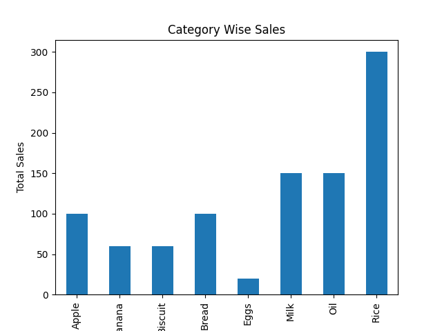
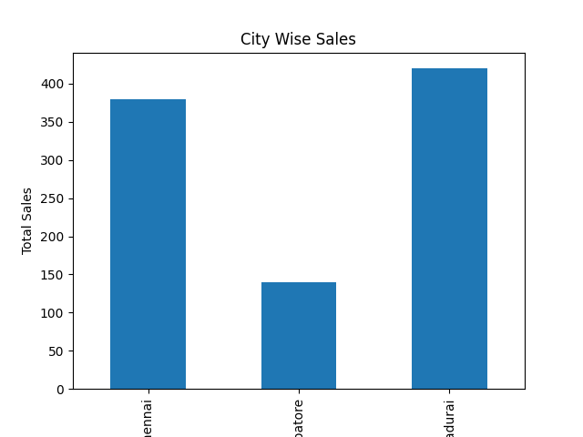
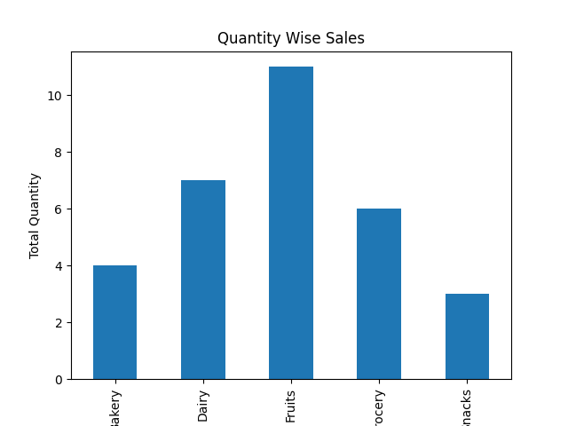

# Grocery Sales Analysis

## Project Overview
This project analyzes grocery sales
data to understand sales performance and product trends.

## Objective
To analyze grocery sales and identity useful business insights.

## Tools Used
- Microsoft Excel
- SQL
- Python
- Pandas
- Matplotlib
- Power BI

## Project Files
- Grocery Sales Dataset
- Python Analysis
- Power BI Dashboard
- Sales Visualization Charts

## Analysis
- Product-wise Sales
- Category-wise Sales
- City-wise Sales
- Quantity-wise Sales

## Project Tasks
- Data Cleaning
- Data Analysis
- Product Wise Sales Analysis
- City Wise Analysis
- Category Wise Analysis
- Data visualization

## Conclusion
This project helps understand grocery sales performance through data analysis and 
visualization.

## Author
Swathi D

## Dashboard Visualization

### 1. Category Wise Sales

### 2. City Wise Sales

### 3. Product Wise Sales

### 4. Quantity Wise Sales

